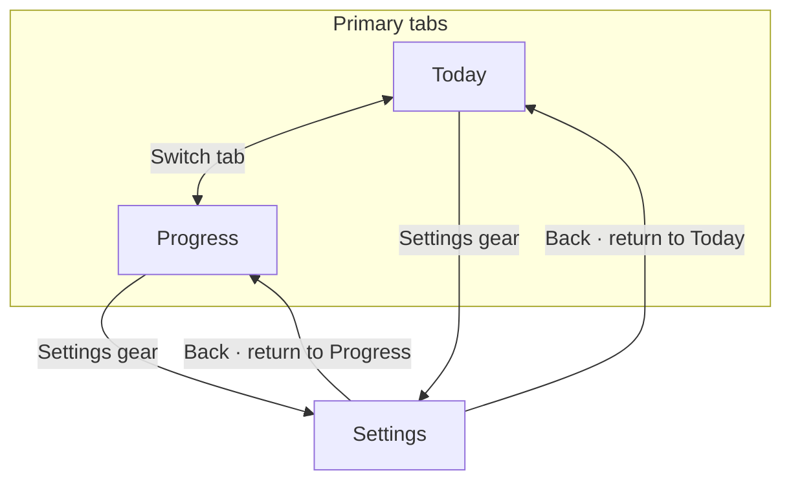

# Phase 1 UX flows and visual system

## Status and scope

This is the Phase 1 design handoff for the agreed product in [`../plan.md`](../plan.md).
It turns the Today, Progress, and Settings requirements into screen structure and
presentation rules. It does not claim stakeholder sign-off or introduce product
behavior beyond that plan.

Phase 1 defines the presentation and navigation shell. Phase 2 owns local data,
manual totals, goal history, language selection, and clear-data behavior. Phase 3
owns HealthKit permissions, refresh, and health-specific states. Empty design
slots are not permission or data claims.

## Navigation and user journeys

| Journey | Sequence |
| --- | --- |
| Check today's steps | Open the app to Today. Read the total, goal, progress, and source. |
| Review recent days | Select Progress from the primary tabs. Read today and the previous six device-local dates. |
| Open Settings from Today | Select the gear in the Today header. Return to Today from Settings. |
| Open Settings from Progress | Select the gear in the Progress header. Return to Progress from Settings. |
| Reach a manual total | In Progress, choose one of the seven displayed dates and use that date's manual-total controls. Phase 2 defines save, edit, and removal behavior. |

Today and Progress are the only primary tabs. Settings is a destination reached
from either tab, not a third tab. Preserve the originating tab when returning
from Settings.

### Navigation flow



### Low-fidelity wireframes

These layouts show hierarchy and destinations, not final styling or interactive
behavior. Settings is opened from either tab's header and its Back action
returns to the originating tab.

**Today**

```text
+--------------------------------------+
| Today · Thu, Oct 29              [⚙] |
|                                      |
|             .--------.               |
|            / 6,420    \              |
|           |   steps    |             |
|            \__________/              |
|       6,420 / 8,000 · 0.80× goal     |
|                                      |
| Source: Health                       |
|                                      |
|       [ original character art ]     |
|                                      |
|      Today  ●             Progress   |
+--------------------------------------+
```

**Progress**

```text
+--------------------------------------+
| Progress · last 7 local days     [⚙] |
|                                      |
| Today · Oct 29                       |
| 6,420 steps · Goal 8,000 · Health    |
| [Add / edit manual total · Oct 29]   |
|--------------------------------------|
| Wed · Oct 28                         |
| 7,100 steps · Goal 8,000 · Manual    |
| [Add / edit manual total · Oct 28]   |
|--------------------------------------|
| Tue · Oct 27                         |
| 3,200 steps · Goal 8,000 · Health    |
| [Add / edit manual total · Oct 27]   |
|--------------------------------------|
| Mon · Oct 26                         |
| 5,400 steps · Goal 8,000 · Health    |
| [Add / edit manual total · Oct 26]   |
|--------------------------------------|
| Sun · Oct 25                         |
| 0 steps · Goal 8,000 · Health        |
| [Add / edit manual total · Oct 25]   |
|--------------------------------------|
| Sat · Oct 24                         |
| 8,200 steps · Goal 8,000 · Health    |
| [Add / edit manual total · Oct 24]   |
|--------------------------------------|
| Fri · Oct 23                         |
| 2,100 steps · Goal 8,000 · Health    |
| [Add / edit manual total · Oct 23]   |
|                                      |
|      Today               Progress ●  |
+--------------------------------------+
```

Each date's manual total replaces that date's Health total; it is not added to
it. The per-date action adds a total when none exists and edits it when one is
already present.

**Settings**

```text
+--------------------------------------+
| [Back to Today or Progress]          |
| Settings                             |
|                                      |
| Daily step goal                   >  |
| Language                          >  |
| Health access                     >  |
|                                      |
| Clear app data                    >  |
|   Confirm before clearing             |
|                                      |
| Data stays on this device.            |
| It may be lost if the app is          |
| uninstalled or the device is replaced.|
+--------------------------------------+
```

## Screen layouts

### Today

1. Header: app identity, current device-local date, and Settings gear.
2. Main summary: a circular progress ring, exact step total, and the active goal.
3. Goal ratio: show the uncapped ratio as text, including values above `1×`.
4. Source: identify the total as Health or Manual. Do not combine the two.
5. Character: original pixel-art artwork, with a goal-reached presentation that
   does not obscure the step total or source.

The ring fills clockwise and visually caps at the goal. The exact count remains
visible, and the uncapped ratio remains available in visible text and the
screen-reader description. A completed ring must not imply that the exact total
stops increasing.

### Progress

Show seven date rows, newest first: today and the previous six device-local
dates. Each row reserves clear space for the date, daily total, that date's
goal, source label, and manual-total affordance. A manual total replaces the
Health total for that date; it is never added to it. Keep the date's source
visible when a manual total is active.

### Settings

Use a simple list of destinations for goal, language, Health access, and
confirmed Clear app data. The gear in both primary-tab headers opens this same
Settings surface. Phase 2 owns goal, language, and clear-data behavior; Phase 3
owns Health access behavior. Include the device-local data-loss disclosure in
this surface.

## Presentation states

These are presentation slots for the screen shell. Owning phases supply the
actual data and transitions.

| State | Presentation rule | Owner |
| --- | --- | --- |
| Loading | Use a clear loading treatment; never show a fabricated zero as a loaded total. | Phase 1 shell; data owners provide the trigger. |
| No Health steps found | Use neutral wording, guide the user to review Health access in Settings, and keep manual entry available. Do not imply access was denied. | Phase 3 for Health data; Phase 2 for manual totals. |
| Health source unavailable | Distinguish an unavailable Health source from a Health source with no steps. Keep manual tracking reachable. | Phase 3 for Health; Phase 2 for manual data. |
| Error | Show an explicit error treatment rather than a success-shaped value. Retry or recovery behavior belongs to the owning phase. | Phase 2 for local persistence; Phase 3 for Health refresh. |
| Goal reached | Keep the ring full, show the exact total and uncapped ratio, and show the character's goal-reached presentation. | Phase 1 presentation; Phase 2 data. |

## Visual system

| Role | Direction |
| --- | --- |
| Main canvas | Cream `#FAF3E6`. |
| Primary accent | Mint `#C8EBDD` for supportive surfaces and emphasis. |
| Primary text | Warm brown `#5B4634` for readable labels and values. |
| Secondary accents | Pastel colors from the agreed palette for decoration and secondary emphasis; never use color as the only status cue. |
| Typography | Use the agreed Nunito/Lexend direction: Nunito for display headings and Lexend for body labels and step numerals. Preserve platform text scaling. |
| Surfaces | Rounded cards with consistent spacing and clear separation between the main total, source, and secondary controls. |
| Character art | Original pixel art made for this app. Treat the reference as palette inspiration only; do not copy its artwork or screen layouts. |

Use the step total and goal as the strongest visual hierarchy on Today. Keep
source and state labels legible without relying on pastel contrast alone. Check
text and control contrast against WCAG AA during implementation.

## Accessibility and responsive layout

- Keep all content in a single-column flow at narrow widths; allow vertical
  scrolling instead of clipping or horizontal scrolling.
- Let longer English and Vietnamese labels wrap and expand cards. Do not
  truncate a source, date, goal, or action label.
- Respect system text scaling. Reflow content when larger text no longer fits;
  do not shrink text to preserve a fixed card height.
- Give each action a clear accessible name and a comfortable, platform-appropriate
  hit area. Keep focus order aligned with the visual reading order.
- Expose the step total, goal, source, and uncapped ratio as meaningful text or
  accessible values. The progress ring's color and fill alone are not a status.
- Pair state color with text and, where useful, a distinct icon. Check contrast
  for actual foreground/background pairs in both languages.

## Phase ownership and review checklist

| Requirement | Design location | Implementation owner |
| --- | --- | --- |
| Today, Progress, and Settings journeys | Navigation and user journeys | Phase 1 |
| Capped clockwise ring, exact total, and uncapped ratio | Today | Phase 1 presentation; Phase 2 data |
| Seven local dates and manual-total affordance | Progress | Phase 1 presentation; Phase 2 behavior |
| Goal, language, Health access, and clear-data destinations | Settings | Phase 1 presentation; Phases 2 and 3 behavior |
| Loading, empty, unavailable, and error distinctions | Presentation states | Phases 2 and 3 provide source-specific behavior |
| Contrast, touch targets, screen readers, text scaling, narrow screens, and bilingual expansion | Accessibility and responsive layout | Phase 1 verification |
| Original character art and agreed palette direction | Visual system | Phase 1 |

Implementation review should confirm that these surfaces do not add Android,
onboarding complexity, streaks, reminders, rewards, walk/run logs, or other
features excluded by the source plan. Layout and accessibility claims require
device-size and large-text checks; this design document alone is not evidence
that those checks have passed.
